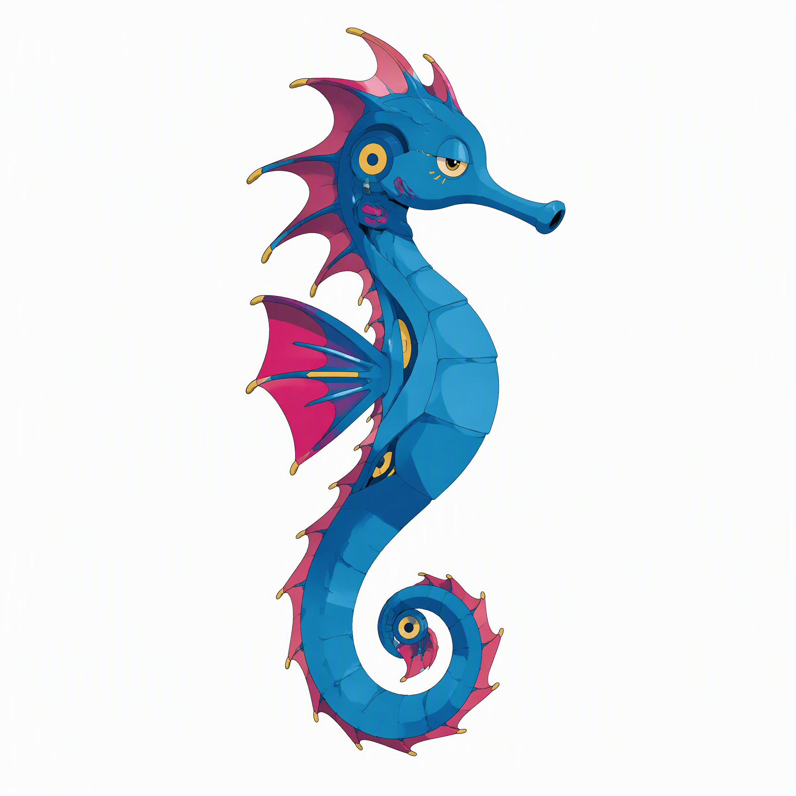
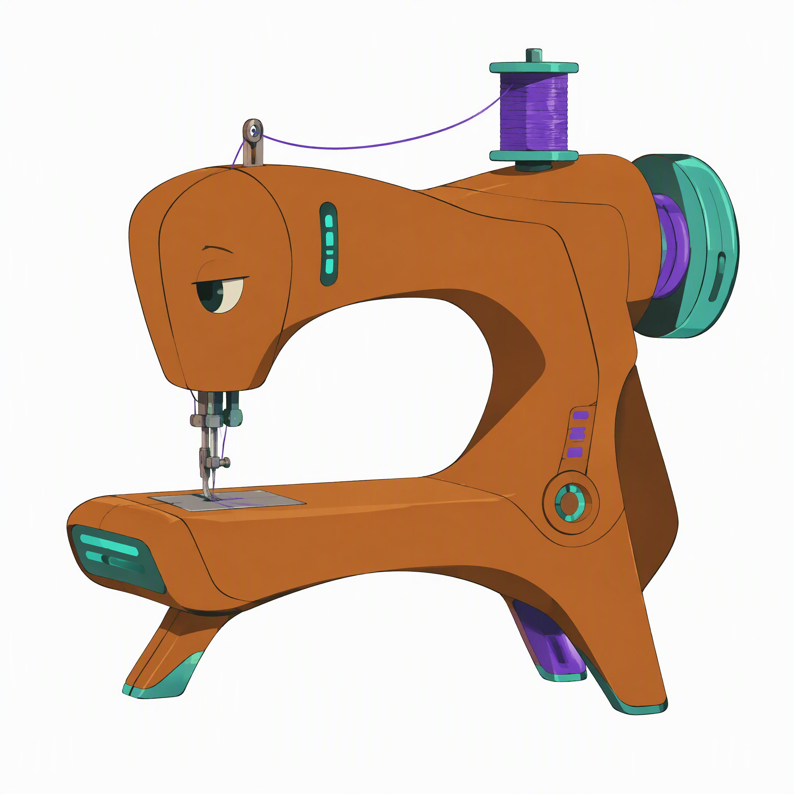
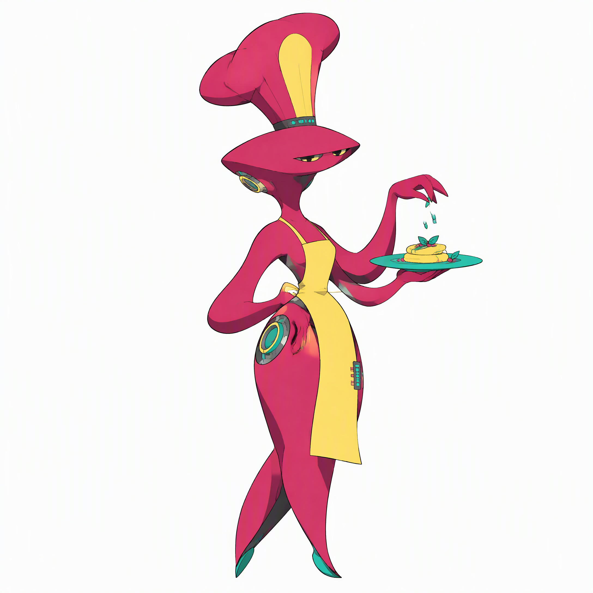

# Cyberpunk Storybook Character

<div align="center">

### 赛璐璐动画 × 赛博朋克

把动物、物件和职业变成有自己形态的未来角色。

**手绘细线 · 鲜明色块 · 动画赛璐璐阴影 · 融入本体的赛博细节**

[快速开始](#快速开始) · [查看 Skill](SKILL.md) · [输出与验收](#输出与验收) · [MIT 许可证](LICENSE)

</div>

<table>
  <tr>
    <td></td>
    <td></td>
    <td></td>
    <td></td>
  </tr>
  <tr align="center"><td>熊猫</td><td>海马</td><td>缝纫机</td><td>厨师</td></tr>
</table>

<p align="center"><sub>以上为实际测试生成的图片；生成结果会随模型与每次运行而变化。示例背景接近白色，未达到严格纯白。</sub></p>

---

## 这是什么？

这是一个角色设计 **Skill**：把一句描述交给支持 Skill 和图像生成的 AI 助手，生成独立的赛博朋克绘本角色。角色采用动画赛璐璐画风，通过轮廓、比例和结构表达主体，并将未来科技细节融入形象。

它是创作指令，不包含图像生成模型，也不是独立应用。该 Skill 与 [Artist Storybook Character](https://github.com/davidai1024/artist-storybook-character) 分开维护。

## 快速开始

### 1. 导入 Skill

将本仓库链接交给支持 Skill 的 AI 助手，请它安装；也可以下载或克隆后，按照助手的说明导入 `SKILL.md`。

```bash
git clone https://github.com/davidai1024/cyberpunk-storybook-character.git
```

如果助手没有 Skill 导入入口，可以让它读取 `SKILL.md` 并按其中的要求创作。需要可用的图像生成能力；不同环境中的工具名称、参数与文件保存路径可能需要适配。

### 2. 描述角色

```text
使用 cyberpunk-storybook-character，生成一个赛博朋克海马。
```

也可以输入「留声机」「消防员」等主体；想要多个角色时，请明确要求**每个角色分别生成一张图**。

### 3. 检查结果

检查主体是否清晰可辨、角色是否完整，以及赛璐璐风格和赛博结构细节是否体现。背景要求纯白，但实际生成可能偏白，需检查后再使用。

## 输出与验收

| 项目 | 默认要求 |
| :--- | :--- |
| 内容 | 每张一个完整的独立角色 |
| 画风 | 复古未来主义动画赛璐璐、细轮廓与清晰色块 |
| 背景 | 不透明纯白 `#FFFFFF`；实际结果需要验证 |
| 尺寸 | 1:1，目标 4K；实际尺寸取决于图像服务 |
| 格式 | PNG 位图，不是 3D 模型或可编辑 SVG |

## 关于生成结果

- 固定主提示词让创作方法一致；配色指令根据输入的 UTF-8 字节计算。用户明确指定的颜色优先。
- 不同文字输入、模型或生成次数可能产生不同结果；配色指令可复算，但图像本身不保证复现。
- 图像模型可能无法严格执行色值或纯白背景要求。实际测试图分辨率为 2176 × 2176，背景接近白色但并非严格纯白。
- 除非当前请求明确提供参考图并要求使用，否则默认独立生成，不沿用之前的图像。

## 开源与使用边界

Skill 与说明文档采用 [MIT 许可证](LICENSE)。展示图及生成图片的使用同时受图像服务条款及相关权利约束，本仓库不授予第三方商标或肖像权利。

---

<p align="center">由 <a href="https://github.com/davidai1024">职场咸鱼</a> 创作与维护</p>
